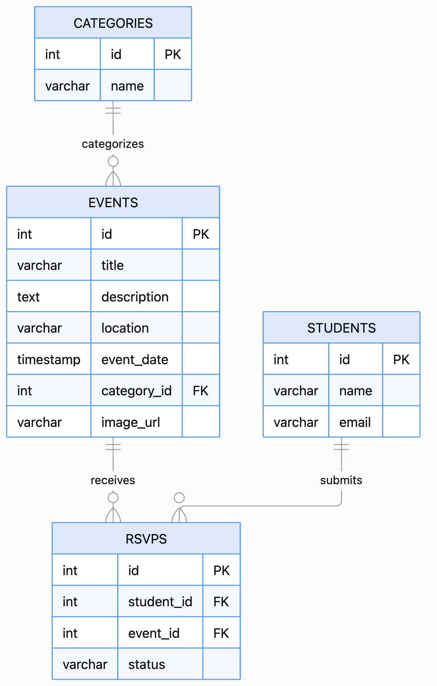

# Entity Relationship Diagram

Reference the Creating an Entity Relationship Diagram final project guide in the course portal for more information about how to complete this deliverable.

## Create the List of Tables

The School.event database consists of four tables:

1. **categories** — Stores event categories such as Academic, Social, Sports, and Career.
2. **events** — Stores event details, including the title, description, location, date, image URL, and category.
3. **students** — Stores student information, including their names and email addresses.
4. **rsvps** — Connects students to events and stores their RSVP status ("Going" or "Interested").

### Database Relationships

- **One-to-Many:** One category can have multiple events, but each event belongs to one category.
- **Many-to-Many:** Students can RSVP to multiple events, and each event can have multiple students. This relationship is managed through the `rsvps` table.

## Add the Entity Relationship Diagram

The diagram below illustrates the database tables, their primary and foreign keys, and the relationships between them.

